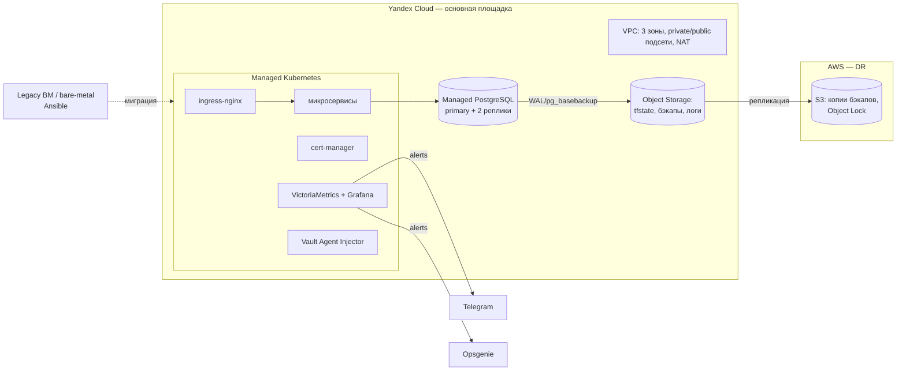

# platform-infra

[](https://github.com/GiitEnjoyer/platform-infra/actions/workflows/validate.yml)

Инфраструктура отказоустойчивой микросервисной платформы под highload-нагрузку: облако описано кодом (Terraform + Terragrunt), конфигурация ВМ — Ansible, Kubernetes-кластер с базовыми платформенными сервисами, наблюдаемость на VictoriaMetrics/Grafana, секреты в HashiCorp Vault, FinOps-аудит утилизации ресурсов.

> Демонстрационный проект. Воспроизводит архитектуру и инженерные практики, которые я применяю на коммерческих проектах (они под NDA). Код написан с нуля и не содержит кода, данных и конфигураций заказчиков.

Прикладная часть (сервисы, Helm-чарты, Canary/Blue-Green в GitLab CI) — в соседнем репозитории [shop-platform](https://github.com/GiitEnjoyer/shop-platform).

## Архитектура



Подробно: [docs/architecture.md](docs/architecture.md), решения — [docs/adr](docs/adr).

## Что внутри

| Каталог | Содержимое |
|---|---|
| `terraform/modules/` | Переиспользуемые модули: `vpc`, `k8s-cluster`, `postgresql`, `aws-dr-bucket` |
| `live/` | Terragrunt-окружения `dev` / `prod`: DRY-конфигурация, remote state в Object Storage с блокировкой |
| `ansible/` | Роли `common` (hardening, sysctl, ssh), `node_exporter`, `pg_backup`; плейбуки для ВМ вне Kubernetes |
| `kubernetes/platform/` | Helmfile платформенных сервисов: ingress-nginx, cert-manager, VictoriaMetrics stack, Vault, VPA |
| `kubernetes/rbac/` | Namespace-per-team, роли для разработчиков и CI, ResourceQuota/LimitRange |
| `observability/` | Правила алертов с unit-тестами, маршрутизация Alertmanager в Telegram/Opsgenie, дашборд Grafana |
| `observability/logging/` | Filebeat → Elasticsearch: фильтрация шума на узле, data streams, ILM-политики хранения по классам логов |
| `finops/` | Скрипт аудита requests/limits против фактического потребления с рекомендациями по right-sizing |
| `scripts/` | Bootstrap remote state, бэкап PostgreSQL |
| `docs/` | Архитектура, ADR, runbooks |

## Быстрый старт

Требования: Terraform ≥ 1.6, Terragrunt ≥ 0.55, `yc` CLI, Ansible ≥ 2.15, Helm 3, helmfile.

```bash
# 1. Бакет и таблица блокировок для remote state (однократно)
export YC_FOLDER_ID=... YC_CLOUD_ID=...
./scripts/bootstrap-backend.sh

# 2. Сеть, кластер и БД окружения dev одним прогоном
cd live/dev
terragrunt run-all plan
terragrunt run-all apply

# 3. Платформенные сервисы в кластере
yc managed-kubernetes cluster get-credentials dev-k8s --external
cd ../../kubernetes/platform && helmfile -e dev apply

# 4. ВМ вне Kubernetes
cd ../../ansible && ansible-playbook -i inventories/dev playbooks/site.yml
```

Полная пересборка тестового окружения с нуля занимает около 15 минут: сеть и кластер создаются параллельно с БД, платформенные сервисы — одним `helmfile apply`.

## Инженерные решения

- **Terragrunt вместо копипасты окружений.** Модуль описан один раз, окружение задаёт только входы (`env.hcl`). Зависимости между стеками (`dependency "vpc"`) позволяют `run-all` строить граф и применять параллельно.
- **State изолирован по стеку и окружению**: `<env>/<stack>/terraform.tfstate`, блокировка через YDB (DynamoDB-совместимый API). Ошибка в одном стеке не блокирует остальные.
- **Production-кластер — региональный** (мастера в трёх зонах), node groups раздельные: `system` (taint под платформенные сервисы) и `apps` с автомасштабированием.
- **Секреты не попадают в Git и в outputs**: пароли БД генерирует Terraform и сразу пишет в Vault; приложения читают их только из Vault через Vault Agent Injector. State хранится в зашифрованном бакете, доступ к нему есть только у сервисного аккаунта CI.
- **Наблюдаемость с первого дня**: каждый стек приходит с алертами; алерты делятся на `critical` → Opsgenie (дежурный) и `warning` → Telegram.
- **Логи стоят денег**: probes/metrics и debug-строки отбрасываются Filebeat до индексации; ingress-логи живут 7 дней, прикладные — 14, аудит — 180 (холодный tier).
- **FinOps как регулярная процедура**: `finops/resource_audit.py` раз в неделю в CI сравнивает requests с p95 потребления и формирует отчёт; HPA/VPA закрывают пиковую нагрузку без постоянного overprovisioning.

## CI

- `.gitlab-ci.yml` — основной пайплайн: `fmt` → `validate` → `tflint` → `checkov` → `plan` (артефакт в MR) → `apply` вручную для `prod`.
- `.github/workflows/validate.yml` — зеркальная проверка для GitHub: форматирование и валидация Terraform, yamllint, ansible-lint, тесты FinOps-скрипта.

## Лицензия

MIT
