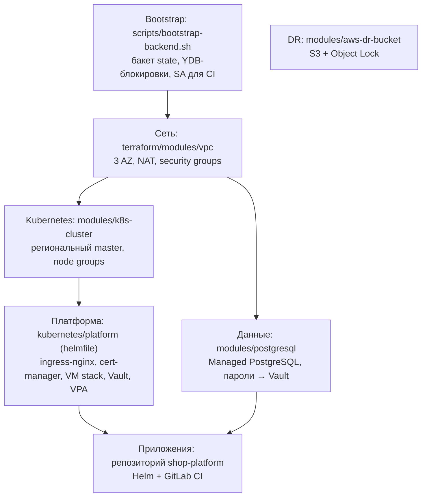
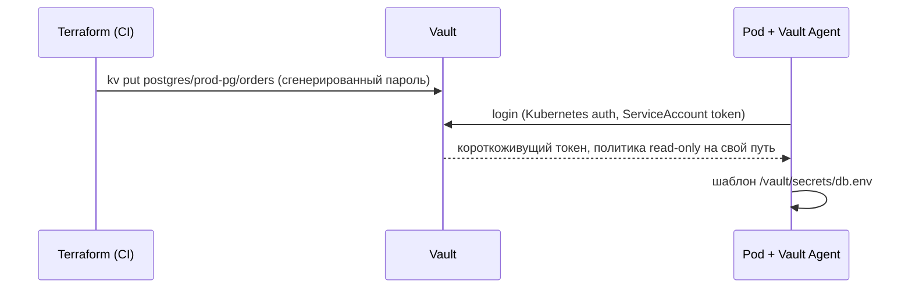

# Архитектура платформы

## Цели и ограничения

| Требование | Значение |
|---|---|
| Пиковая нагрузка | 50 000+ RPS на ingress |
| Доступность | 99,95 % для пользовательского API (SLO), 99,99 % для оплаты |
| RPO / RTO БД | RPO ≤ 5 мин (WAL), RTO ≤ 30 мин; off-site копия в другом облаке |
| Время развёртывания тестового окружения | ≤ 15 мин с нуля |
| Окружения | `dev` (дешёвое, preemptible), `prod` (региональное HA) |

## Слои

Каждый слой — отдельный state. Изменение платформенных сервисов не требует доступа к state сети, а ошибка в приложениях не может затронуть VPC.

## Сеть

- Три приватные подсети `/20` (по одной на зону) — узлы кластера и БД; три публичные `/24` — балансировщики и bastion.
- Исходящий трафик из приватных подсетей — через managed NAT gateway; у узлов нет публичных IP.
- API-сервер production-кластера доступен только изнутри VPC (через VPN/bastion).

## Kubernetes

| Node group | Назначение | Масштабирование |
|---|---|---|
| `system` | ingress-nginx, мониторинг, Vault, cert-manager (taint `dedicated=system`) | фиксировано 3 узла |
| `apps` | прикладные сервисы | cluster-autoscaler 6–30 |
| `batch` | фоновые задачи, отчёты (preemptible, taint `workload=batch`) | 0–10 |

Отказоустойчивость: master в трёх зонах; ingress-nginx и Vault разнесены по зонам через `topologySpreadConstraints` / `podAntiAffinity`; у каждого сервиса есть PodDisruptionBudget, поэтому auto-upgrade узлов не роняет трафик.

## Наблюдаемость

- **Метрики:** vmagent → VictoriaMetrics single (90 дней хранения в prod). Отказ от Prometheus + Thanos обоснован в [ADR-0002](adr/0002-victoriametrics.md).
- **Алерты:** `observability/platform-alerts` — правила в формате Prometheus, покрыты `promtool test`. Маршрутизация: `critical` → Opsgenie + Telegram, `warning` → Telegram, Watchdog → heartbeat Opsgenie (обнаружение отказа самого мониторинга).
- **Логи:** ingress и сервисы пишут JSON; Filebeat (`observability/logging`) разбирает поля на узле и пишет в data streams Elasticsearch с отдельными ILM-политиками.
- **Дашборды:** `observability/dashboards` — подключаются sidecar-ом Grafana из ConfigMap.

## Секреты

## FinOps

1. Метки `env`, `cost_center`, `team` на всех облачных ресурсах и namespace — основа отчёта о затратах.
2. Еженедельный `finops:audit` сравнивает requests с p95 потребления и выдаёт таблицу с рекомендациями и оценкой экономии.
3. VPA работает в режиме рекомендаций; изменения requests проходят через MR в репозитории приложения.
4. Batch-нагрузка вынесена на preemptible-узлы, dev-окружение целиком на preemptible.
5. Хранение логов: шум отбрасывается до индексации, `best_compression`, warm-tier без реплик, разная ретенция по классам логов.
6. В vmagent отброшены высококардинальные метрики, которые никто не запрашивает.
